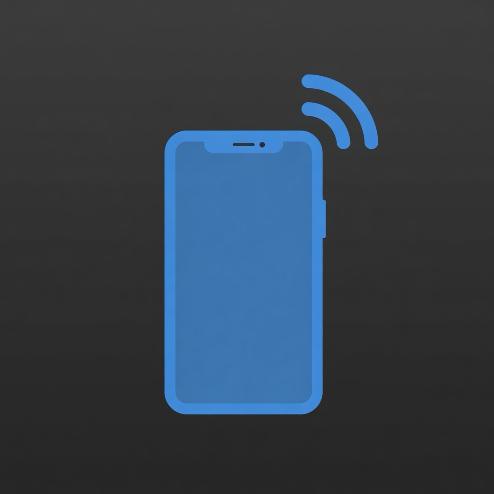
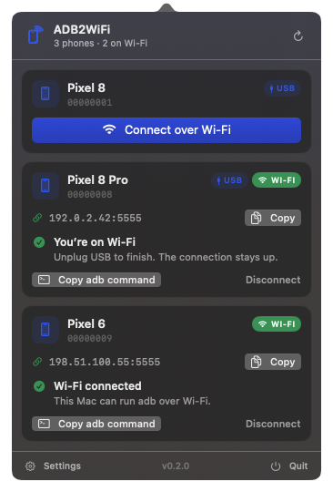
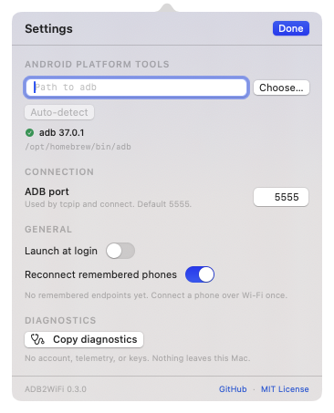

<div align="center">
  
  <h1>ADB2WiFi</h1>
  <p><strong>One click from USB to Wi-Fi ADB.</strong><br>A tiny, native macOS menu-bar app.</p>
  <p>
    
    
    
    
  </p>
  
</div>

## Why

Android's Wi-Fi ADB setup is a handful of terminal commands with no obvious way to
know whether it worked. ADB2WiFi turns it into one button:

1. **Plug in** a phone over USB.
2. **Click** the menu-bar icon and tap **Connect over Wi-Fi**.
3. **Unplug** when the card says *You're on Wi-Fi*.

It runs `adb tcpip`, connects to the phone's own Wi-Fi address, and verifies the
remote serial number before declaring success. No root, no scripts, no accounts.

- **Native and quiet** — SwiftUI, zero third-party dependencies, no Dock icon, no main window.
- **Private by default** — no telemetry, no cloud, no API keys. Everything stays on your Mac.
- **Hard to get wrong** — clear setup, bounded retries, identity verification, and a copy-ready `adb connect` command.
- **Low overhead** — adaptive polling, one coalesced `adb devices` call, and no subprocesses while the Mac sleeps.

## Install

### Requirements

- macOS 14 Sonoma or later
- Android Platform Tools (`adb`) already on the Mac — ADB2WiFi never downloads or bundles it

```sh
brew install --cask android-platform-tools
```

Or use the `adb` that ships with Android Studio.

### Download

Grab `ADB2WiFi-<version>.zip` from the [latest release](https://github.com/MarioCodarin/ADB2WiFi/releases/latest),
unzip it, and move `ADB2WiFi.app` to `/Applications`.

The app is ad-hoc signed, not notarized. If macOS blocks the first launch,
right-click the app and choose **Open**, or clear the quarantine flag:

```sh
xattr -dr com.apple.quarantine /Applications/ADB2WiFi.app
```

### Build from source

```sh
git clone https://github.com/MarioCodarin/ADB2WiFi.git
cd ADB2WiFi
bash Scripts/install.sh
```

`install.sh` builds a release app, installs it to `/Applications`, and opens it.
You only need the Swift toolchain from Xcode or the Command Line Tools.

## First run

1. On the phone, enable **Developer options → USB debugging**.
2. Plug in USB and tap **Allow** on the phone.
3. Open ADB2WiFi and press **Connect over Wi-Fi**.
4. When the card turns green, unplug USB. The ADB connection stays up.

If ADB is missing, the popover becomes a setup screen with a path picker and a
copy-ready Homebrew command. No terminal required.

## Configuration

Everything is in the popover's **Settings** pane.

| Setting | What it does |
|---|---|
| **ADB path** | Auto-detects, or pick any `adb` executable. |
| **Port** | Port used by `adb tcpip` and the generated endpoint. Default `5555`. |
| **Launch at login** | Starts ADB2WiFi quietly when you log in. |
| **Copy diagnostics** | Copies a redacted support report (no serials, IPs, or usernames). |

<p align="center"></p>

ADB discovery order: the path chosen in Settings → `$ADB2WIFI_ADB_PATH` →
Homebrew (`/opt/homebrew/bin/adb`) → `/usr/local/bin/adb` → MacPorts →
`~/Library/Android/sdk/platform-tools/adb` → `$ANDROID_HOME` / `$ANDROID_SDK_ROOT` →
every directory in `PATH`.

Advanced users can override the path for a single launch:

```sh
open -a ADB2WiFi --env ADB2WIFI_ADB_PATH=/path/to/adb
```

Settings are stored locally in `~/Library/Preferences/io.github.mariocodarin.ADB2WiFi.plist`.
Nothing is written to the repository, and no key or token is involved.

### Where do I put my keys?

There aren't any. ADB2WiFi has no accounts, no API keys, and no cloud service.
The only machine-specific input is your `adb` path, which is auto-detected or
chosen in Settings. That is the whole setup.

## How it works

| Step | Command | Why |
|---|---|---|
| 1. Find address | `adb -s <usb> shell ip -o -4 addr show up` | Works with `wlan`, `wifi`, `wl`, `swlan`, and hotspot interfaces — never assumes `wlan0`. |
| 2. Enable Wi-Fi | `adb -s <usb> tcpip 5555` | Android's USB-initiated wireless debugging path. |
| 3. Connect | `adb connect <ipv4>:5555` | Retries for up to 20 seconds; success is decided by stdout, not exit code. |
| 4. Verify | `adb -s <endpoint> shell getprop ro.serialno` | The endpoint must be the same phone. A mismatch is disconnected. |

The app never runs `adb kill-server`, never uses a shell to build commands, and
keeps in-flight work alive when you close the popover. **Quit** does not tear down
an established Wi-Fi connection.

> Wi-Fi ADB is unencrypted. Use it only on a trusted network.

## Privacy

- No analytics, telemetry, accounts, or network calls other than to your phone over ADB.
- Serial numbers and IP addresses are logged as private values in the unified log.
- **Copy diagnostics** redacts your home directory and contains no device identifiers.
- See [SECURITY.md](SECURITY.md) for the full data story.

## Logs

```sh
log stream --predicate 'subsystem == "io.github.mariocodarin.ADB2WiFi"' --level debug
```

Every line is key-value shaped, for example:

```text
poll total=2 added=1 removed=0 duration=38ms
connect start manual=false port=5555
```

## Troubleshooting

| Symptom | Fix |
|---|---|
| **ADB not found** | `brew install --cask android-platform-tools`, then choose the path in Settings. |
| **Authorization needed** | Unlock the phone and tap **Allow** on the USB debugging prompt. |
| **Phone offline** | Reconnect the cable; check that USB debugging is still on. |
| **No Wi-Fi address** | Join a Wi-Fi network on the phone. A hotspot interface also works. |
| **Can't reach phone** | Put the Mac and phone on the same network. VPNs and guest networks can block the connection. |
| **Wrong device** | Another phone answered at that endpoint. Disconnect it, then retry. |
| **Timed out** | Keep USB connected and retry. Some phones need a moment after `tcpip`. |

## Development

```sh
swift build                        # debug build
bash Scripts/test.sh               # 132 Swift Testing tests
bash Scripts/package-app.sh        # arm64 app in dist/
bash Scripts/package-app.sh --universal
bash Scripts/release.sh            # universal zip + SHA-256
```

Use `bash Scripts/test.sh`, not bare `swift test`, when the active toolchain is
Command Line Tools only: CLT ships the Testing framework but not the macro plugin,
so the script loads it explicitly. Xcode toolchains work with both commands.

Project layout:

```text
Sources/ADB2WiFiCore   UI-free ADB client, parsers, device store, connection coordinator
Sources/ADB2WiFi       NSStatusItem, NSPopover, SwiftUI views
Tests/                 Swift Testing coverage for the core
Scripts/               test, package, install, release
docs/                  architecture, roadmap, screenshots
```

See [docs/ARCHITECTURE.md](docs/ARCHITECTURE.md) for the design and invariants,
and [docs/ROADMAP.md](docs/ROADMAP.md) for what is next.

## Contributing

Ideas, bug reports, and pull requests are welcome. Read
[CONTRIBUTING.md](CONTRIBUTING.md) first. Please never paste real serial numbers
or IP addresses into an issue.

## License

[MIT](LICENSE) © 2026 Mario Codarin.
